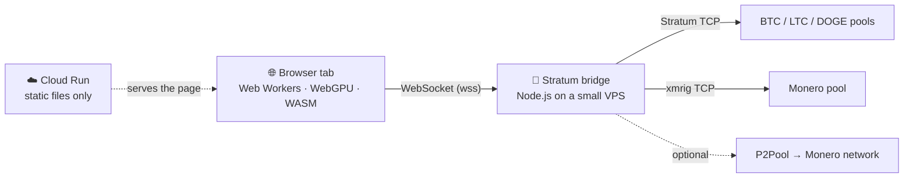

<div align="center">

# ⛏️ Browser Crypto Miner

### Mine real **Bitcoin · Litecoin · Dogecoin · Monero** proof-of-work from a single browser tab.

No install. No extension. No wallet connect. Open a page, paste an address, press start.

[](https://miner.tensors.vip)


**[🚀 Try it live → miner.tensors.vip](https://miner.tensors.vip)**

</div>

---

## Why this exists

Proof-of-work is usually something you install. This project asks a different question: **how close can a plain browser tab get to the real thing?**

Everything the page hashes is a genuine candidate for a real block on a real network:

- 🔐 **Real algorithms, written for the browser.** Double-SHA-256 with a WebGPU kernel, Scrypt in JavaScript, and RandomX compiled to WebAssembly. Each one is checked against known-answer vectors and against independent implementations.
- 🌐 **Real pools.** Shares go to live Stratum pools through a tiny WebSocket bridge, since browsers cannot open raw TCP sockets.
- 🧩 **Four coins, five modes.** Solo, shared pool, merged LTC + DOGE, Monero over decentralized P2Pool, or any custom pool you point it at.
- 🪶 **Light to run.** The frontend is a few static files. The bridge is a single Node process that fits in a 1 GB VPS.
- 🧪 **Honest by design.** The miner only ever submits a share that actually clears the pool's bar. It never fabricates one.

> **Be realistic.** A browser tab will not make you money. At today's network difficulties, finding a block from a tab is a lottery ticket measured in millions of years. This is a research and engineering demo of what the web platform can do, built in collaboration with a Bitcoin mining pool research lab.

## Features

| | |
|---|---|
| **Coins** | Bitcoin, Litecoin, Dogecoin, Monero, with per-coin wallet address validation so a BTC address can never credit an LTC share |
| **Engines** | CPU Web Workers (all coins), WebGPU WGSL SHA-256d kernel (BTC), WebAssembly RandomX VM (XMR) |
| **Modes** | Solo · Shared pool · Merged (LTC + DOGE auxpow) · P2Pool (XMR) · Custom pool |
| **Live telemetry** | Hashrate, current block, network difficulty, share difficulty, best share, and a console that logs every connection, job and share |
| **Bridge** | Stratum v1 and xmrig dialects relayed unchanged, so every share is credited to *your* login. No dev fee |
| **UI** | Single page, themed like [tensors.vip](https://tensors.vip), with an FAQ drawer that explains every setting |

## Supported coins

| Coin | Algorithm | Browser engine | Wire protocol | Default solo upstream |
| --- | --- | --- | --- | --- |
| **Bitcoin** `BTC` | double-SHA-256d | `miner-worker.js` (CPU) and/or WebGPU kernel | Stratum v1 | `solo.ckpool.org:3333` |
| **Litecoin** `LTC` | Scrypt (N=1024, r=1, p=1) | `scrypt-worker.js` (CPU) | Stratum v1 | `ltc.viabtc.io:3333` |
| **Dogecoin** `DOGE` | Scrypt | `scrypt-worker.js` (CPU) | Stratum v1 | `doge.mine.zpool.ca:3333` |
| **Monero** `XMR` | RandomX (light mode, 256 MiB cache) | `xmr-worker.js` + `randomx.wasm` (CPU) | xmrig `login` / `job` / `submit` | `pool.supportxmr.com:3333` |

Shared-pool defaults: btcpowlab (BTC), viabtc (LTC), zpool (DOGE) and **P2Pool** (XMR, optional, see below).

## Mining modes

| Mode | What it does |
| --- | --- |
| **Solo** *(default)* | Your own address is the payout address. If one of your shares solves a block, the full reward is yours. |
| **Shared pool** | No account needed. Your address is used as the worker login and credited by the pool. |
| **Merged (LTC + DOGE)** | One Scrypt session at an LTC pool that embeds Dogecoin blocks in the Litecoin blocks it finds, so the same work counts on both chains. |
| **P2Pool (XMR)** | A decentralized Monero pool with no operator, paid straight to your address. Needs the optional P2Pool container on the bridge. |
| **Custom pool** | Enter your own host, port and worker login. |

## How fast is it, really?

| Coin | What to expect from a desktop browser |
| --- | --- |
| BTC | Several MH/s on CPU threads, more with the WebGPU kernel |
| LTC / DOGE | Thousands of hashes per second. Scrypt is memory-hard by design |
| XMR | Single to a few dozen H/s. RandomX in WebAssembly light mode is far below native xmrig |

The miner searches at the easiest difficulty so the *Best Share* panel stays alive, and submits only hashes that clear the pool's advertised difficulty. If the pool's floor is out of reach for a browser (public Monero pools and `solo.ckpool.org` both are), the page shows your best local share and submits nothing, rather than faking progress.

## Architecture



- **Cloud Run** only serves a handful of static files through nginx and scales to zero. No mining traffic ever touches it.
- **The VPS** runs the bridge, which is the only part that grows with the number of miners. It relays messages unchanged (it only answers the client's `mining.ping` locally), so it holds no keys and takes no cut.

## Quick start

### Requirements

- Node.js 20+ (bridge and tests)
- Python 3 or any static file server (to serve the frontend)
- Docker (optional, for the container builds)
- A recent Chromium-based browser. WebGPU is optional and only speeds up Bitcoin.

### 1. Run it locally

```bash
git clone https://github.com/kenedii/Browser-Crypto-Miner.git
cd Browser-Crypto-Miner

# Terminal 1: the WebSocket → Stratum bridge (listens on :8080)
cd stratum-bridge && npm install && node bridge.js

# Terminal 2: serve the frontend from the repository root
python3 -m http.server 8000

# Open the page pointed at your local bridge
# http://localhost:8000/mine-crypto.html?bridge=ws://localhost:8080
```

`?bridge=` overrides the bridge URL for that page load only. The default is `wss://stratum.tensors.vip`, so you can try the live bridge first.

### 2. Enable Monero (build the RandomX VM once)

`randomx.wasm` is a build artefact and is not committed. Build it once by following [`WebRandomX/README.md`](WebRandomX/README.md) (an Emscripten toolchain), then copy the result next to `mine-crypto.html`. Without it Bitcoin, Litecoin and Dogecoin work immediately, and the Monero engine reports exactly what is missing and submits nothing.

### 3. Run the tests

```bash
node test_sha256.js             # SHA-256, header and merkle maths vs Node crypto
node test_scrypt.js             # Scrypt vs crypto.scrypt, plus the share-target scale
node test_en2_size.js           # extranonce2 length always matches what the pool advertised
node test_xmr_protocol.js       # Monero seam, ABI checks, the "no fake VM" guarantee
node test_xmr_job_roundtrip.js  # RandomX job normalization survives postMessage
cd stratum-bridge && node test_modes.js
```

## Deploying

### The bridge (any small VPS)

```bash
git clone https://github.com/kenedii/Browser-Crypto-Miner.git /opt/bcm
cd /opt/bcm/stratum-bridge
docker compose up -d --build
```

The compose file runs the bridge and a Caddy reverse proxy that terminates TLS for your domain (edit `Caddyfile`), with memory limits that suit a 1 GB machine. Every pool and routing option is an environment variable, documented in [`stratum-bridge/README.md`](stratum-bridge/README.md).

### Monero through P2Pool (optional)

P2Pool is a decentralized Monero pool, so there is no operator to trust. The bridge ships it as an optional compose profile that talks to a public Monero node. Create `stratum-bridge/.env`:

```ini
P2POOL_WALLET=<your Monero address>
XMR_PPLNS_POOL_HOST=p2pool
COMPOSE_PROFILES=p2pool
```

then run `docker compose up -d --build` again. It runs in light mode (about 256 MiB for the RandomX cache), so add a little swap on a 1 GB VPS. Details are in the bridge README.

### The frontend (Cloud Run)

```bash
gcloud run deploy miner \
  --source . --region us-central1 --allow-unauthenticated \
  --port 80 --min-instances 0 --max-instances 3 \
  --memory 128Mi --cpu 1
```

The multi-stage `Dockerfile` minifies the scripts with terser and serves them with nginx. To try the same image locally:

```bash
docker build -t browser-crypto-miner .
docker run --rm -p 8080:80 browser-crypto-miner   # http://localhost:8080
```

`deploy-all.ps1` chains the git push, the Cloud Run deploy and the VPS update into one PowerShell command.

## How the code is organized

| Path | Role |
| --- | --- |
| `mine-crypto.html` | The page shell: styling, background layers and script loading |
| `miner.js` | The whole UI and the Stratum-over-WebSocket client, plus the WebGPU WGSL SHA-256d kernel |
| `lattice.js` | The decorative cube-lattice and binary-rain background (optional, the miner never depends on it) |
| `sha256.js` | Shared Bitcoin maths: midstate, merkle root, header assembly, target checks. Also loaded by the workers and the tests |
| `miner-worker.js` | CPU worker for SHA-256d, one per thread |
| `scrypt.js` · `scrypt-worker.js` | Scrypt for Litecoin and Dogecoin, with the pool difficulty scaling |
| `randomx.js` · `xmr-worker.js` | RandomX loader and ABI check, and the worker that hashes Monero jobs with the WASM VM |
| `WebRandomX/` | C++ wrapper and build scripts that compile RandomX to WebAssembly, plus a known-answer verifier |
| `stratum-bridge/` | The Node.js WebSocket ⇄ Stratum bridge, its Docker and Caddy config, and the optional P2Pool service |
| `Dockerfile` · `nginx.conf` | Minify-and-serve image for Cloud Run |
| `test_*.js` | Offline tests for the maths and the protocol layers |

### Engineering notes

A few details that took real work, and that the tests protect:

- **Scrypt difficulty scale.** Scrypt pools define difficulty 1 as `0x0000ffff << 224`, which is 65,536× easier than SHA-256d's difficulty 1. `scrypt.js` builds share targets with exact BigInt maths, and `miner.js` converts worker-reported difficulty before comparing it with the pool's.
- **Extranonce2 length.** Each job uses a fresh random extranonce2 whose length must equal what the pool advertised in `mining.subscribe`. A wrong length makes a pool reject every share.
- **RandomX in a browser.** The VM runs from WebAssembly with the floating-point rounding behaviour RandomX's `CFROUND` instruction requires. It passes the official known-answer vectors, so the hashes are consensus-correct.
- **Share verification.** Every nonce a GPU or worker reports is re-verified on the CPU before it is submitted.

## FAQ

**Can it find a block?** In theory, every share is a genuine candidate. In practice the odds from a browser are astronomically small.

**Where do my coins go?** Straight to the address you enter. No account is created and no private key is ever requested.

**Is there a dev fee?** No. The bridge relays messages unchanged, so every share is credited to your login.

**Why a bridge?** Browsers cannot open raw TCP connections, and mining pools speak Stratum over TCP. The bridge translates WebSocket to Stratum and does nothing else.

## Responsible use

Mining uses real CPU and GPU time. Run it on hardware you own, expect it to get warm, and press Stop when you are done. The miner works only while the tab is open.

---

<div align="center">

**[▶ Open the live demo](https://miner.tensors.vip)** · built at [tensors.vip](https://tensors.vip)

</div>
